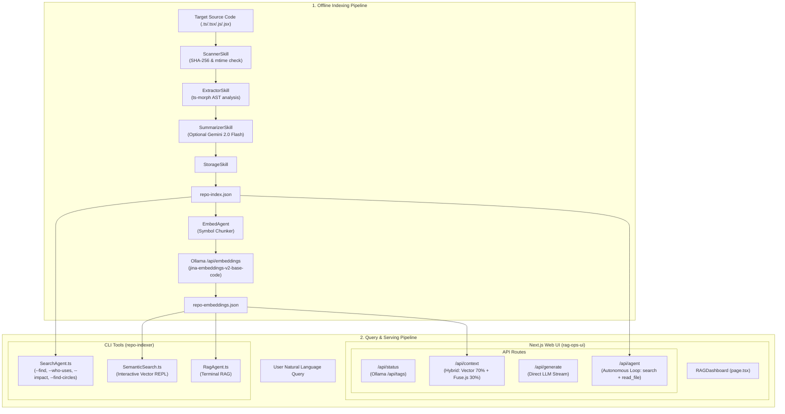

# Local AI Search Engine (RepoMind)

An offline-first, local AI code search, dependency intelligence, and retrieval-augmented generation (RAG) platform. RepoMind indexes TypeScript and JavaScript codebases using Abstract Syntax Tree (AST) parsing via `ts-morph`, extracts code symbols and dependency relationships, computes vector embeddings locally via Ollama (`unclemusclez/jina-embeddings-v2-base-code` / `nomic-embed-text`), and exposes both an extensible command-line toolkit and an interactive Next.js web application (`rag-ops-ui`). It enables developers to perform local semantic code search, hybrid search (combining vector similarity and Fuse.js fuzzy keyword matching), blast-radius impact analysis, circular dependency detection, and autonomous agentic workflows using local LLMs (such as `qwen2.5:3b`) without leaking proprietary code to third-party cloud APIs.

---

## Target Codebase & Data Privacy

RepoMind is codebase-agnostic: configure `WORKSPACE_ROOT` to point to any local TypeScript or JavaScript repository (Next.js, React, Node.js) to scan, index, and analyze it.

During development and benchmark testing, the platform was evaluated on a large-scale enterprise TypeScript/Next.js production application comprising over 1,000 files across pages, components, and API routes.

**Privacy & Security Guarantees**:
- **Zero Remote Leakage**: All generated index files (`repo-index.json`) and vector databases (`repo-embeddings.json`) remain strictly local to your machine and are excluded by `.gitignore`.
- **Path-Traversal Guard**: The agent's file-reading tool validates that resolved file paths strictly reside inside the configured `WORKSPACE_ROOT`, preventing arbitrary filesystem access.
- **Offline Inference**: All embeddings and chat completions run over a local Ollama instance (`localhost:11434`).

---

## Key Features

### 1. Codebase Scanning & AST Metadata Extraction
- **Recursive AST Scanning**: Traverses `.ts`, `.tsx`, `.js`, and `.jsx` files (ignoring `node_modules`, `.next`, `dist`, `build`, `coverage`, and `.git`).
- **Incremental Indexing**: Calculates SHA-256 content hashes and monitors filesystem modification timestamps (`mtime`) to re-index only new or modified files (`repo-indexer/ScannerSkill.ts`, `repo-indexer/RepoIndexAgent.ts`).
- **Deep Symbol Extraction**: Uses `ts-morph` with isolated dependency resolution to extract:
  - Components (PascalCase declarations)
  - React Hooks (`use*` naming convention)
  - Functions & Arrow Functions
  - Function call hierarchies (tracks child function invocations)
  - TypeScript types and interfaces
  - Imported and exported symbol tables
  - Lines of Code (LOC) and JSDoc documentation
- **Next.js App Router Awareness**: Identifies App Router pages, layouts, and API routes (`page.tsx`, `layout.tsx`, `route.ts`), parsing URL paths and route segments.
- **Optional Gemini Summarization**: Optional integration with `@google/genai` (`gemini-2.0-flash`) to generate concise architectural summaries when `GEMINI_API_KEY` is provided (`repo-indexer/SummarizerSkill.ts`).

### 2. Local Vector Embeddings & Storage
- **Granular Symbol Chunking**: Slices files into dedicated chunks per symbol (component, hook, function, route, type) enriched with imports and call references (`repo-indexer/EmbedAgent.ts`).
- **Local Ollama Embeddings**: Generates dense vector embeddings via local Ollama instances (`http://localhost:11434/api/embeddings`) using `unclemusclez/jina-embeddings-v2-base-code`.
- **Deduplication & Incremental Saves**: Reuses existing vector embeddings for unchanged code chunks and periodically flushes progress to disk (`repo-embeddings.json`).

### 3. Graph Analysis & Codebase CLI Queries
The `SearchSkill` and `SearchAgent` CLI offer graph intelligence directly over `repo-index.json`:
- **Broad Symbol Search (`--find`)**: Searches across file paths, exports, components, hooks, functions, and types.
- **Reverse Dependency Lookup (`--who-uses`)**: Finds all files importing a specific symbol or path.
- **Next.js Route Inspection (`--route`)**: Matches URL endpoints to source route files.
- **Blast Radius & Impact Analysis (`--impact`)**: Traverses incoming dependency chains to generate a complete impact tree and flat list of affected files when modifying a symbol.
- **Circular Dependency Detection (`--find-circles`)**: Employs Depth-First Search (DFS) cycle traversal to detect circular import loops across the codebase.
- **Architecture Summarization (`--architecture`)**: Categorizes codebase files into Pages, Components, API Routes, Context & State, Utils & Hooks, and Other.
- **Top Dependencies (`--top-deps`)**: Ranks the most heavily imported files in the project.

### 4. Context Packaging & Terminal RAG
- **Token-Budgeted Context Builder**: Assembles structured context packages with strict token budgets (estimated at 4 characters per token). Performs Phase 1 (core semantic AST matches) followed by Phase 2 (1-hop dependency expansion) (`repo-indexer/ContextBuilderSkill.ts`).
- **Interactive Semantic REPL**: Terminal-based interactive search interface with cosine similarity calculations (`repo-indexer/SemanticSearch.ts`).
- **Terminal RAG Agent**: Command-line RAG pipeline that feeds assembled context packages and strict system prompts into local Ollama models (`qwen2.5:3b` by default) with real-time response streaming (`repo-indexer/RagAgent.ts`).
- **Telemetry Analyzer**: Parses JSONL conversation transcripts to output model reasoning steps, token usage estimates, and tool invocation counts (`repo-indexer/MetricsAnalyzer.ts`).

### 5. Interactive Web Dashboard (`rag-ops-ui`)
Built with Next.js 16, React 19, and Tailwind CSS v4:
- **Real-Time Diagnostics**: Live status polling against Ollama (`/api/status`), displaying active server status and dynamically populating model selection menus.
- **Dual Chat Modes**:
  - **Standard RAG Mode**: Hybrid search query -> context retrieval -> streaming LLM response (includes a **Context Only** toggle to inspect raw retrieved code without invoking an LLM).
  - **Autonomous Agent Mode**: An agentic loop (`/api/agent`) executing multi-turn tool calling (`search_codebase` and `read_entire_file`) with built-in loop breakers and raw markdown JSON fallback parsing.
- **Hybrid Search Scoring**: Blends 70% normalized vector cosine similarity with 30% Fuse.js fuzzy keyword matching (`/api/context`).
- **Context Inspector Pane**: Displays real-time matching code chunks, similarity scores, file paths, total character and token metrics, and provides a one-click clipboard copy of the raw context payload.
- **Markdown & Syntax Highlighting**: Renders responses using `react-markdown`, `remark-gfm`, and `react-syntax-highlighter` (`vscDarkPlus` theme).

---

## Tech Stack

### Web Application (`rag-ops-ui`)
| Category | Technology | Version |
| :--- | :--- | :--- |
| **Framework** | Next.js (App Router) | `16.2.10` |
| **UI Library** | React / React DOM | `19.2.4` |
| **Styling** | Tailwind CSS / PostCSS | `^4` / `@tailwindcss/postcss ^4` |
| **Typography** | `@tailwindcss/typography` | `^0.5.20` |
| **Icons** | Lucide React | `^1.24.0` |
| **Fuzzy Search** | Fuse.js | `^7.5.0` |
| **Markdown Rendering** | ReactMarkdown / remark-gfm | `^10.1.0` / `^4.0.1` |
| **Code Highlighting** | react-syntax-highlighter | `^16.1.1` |
| **TypeScript** | TypeScript | `^5` |

### Indexer & CLI Core (`repo-indexer`)
| Category | Technology | Version |
| :--- | :--- | :--- |
| **Runtime / Execution** | Node.js / `tsx` | Node 20+ / `^4.22.4` |
| **AST Analysis** | `ts-morph` | `^28.0.0` |
| **Cloud AI (Optional)** | `@google/genai` | `^2.9.0` |
| **Config Loader** | `dotenv` | `^17.4.2` |
| **TypeScript** | TypeScript | `^6.0.3` |

### Local AI & Embedding Models
- **Inference Server**: [Ollama](https://ollama.com/) (running at `http://localhost:11434`)
- **Default Embedding Model**: `unclemusclez/jina-embeddings-v2-base-code` (also supports `nomic-embed-text`)
- **Default LLM**: `qwen2.5:3b` (selectable via UI from any locally pulled Ollama chat model)
- **Optional Cloud Model**: `gemini-2.0-flash` (via Google GenAI SDK for indexing summaries)

---

## Architecture Overview

```
Local-AI-Search-Engine/
├── .gitignore                    # Excludes node_modules, build artifacts, db files, env
├── .env.example                  # Template for environment configuration
├── repo-index.json               # (Generated) AST metadata index
├── repo-embeddings.json          # (Generated) Serialized vector database
│
├── repo-indexer/                 # CLI Tools, AST Indexer & Agents
│   ├── ScannerSkill.ts           # Recursive file scanner with SHA-256 hash detection
│   ├── ExtractorSkill.ts         # ts-morph AST parser for symbols, calls, & imports
│   ├── SummarizerSkill.ts        # Optional Gemini API integration for file summaries
│   ├── StorageSkill.ts           # JSON persistence layer for repo-index.json
│   ├── RepoIndexAgent.ts         # Orchestrator for scanning and index generation
│   ├── EmbedAgent.ts             # Generates symbol embeddings via Ollama
│   ├── SearchSkill.ts            # Graph query engine (impact, circles, architecture)
│   ├── SearchAgent.ts            # CLI command wrapper for SearchSkill queries
│   ├── SemanticSearch.ts         # Interactive CLI REPL for semantic vector search
│   ├── ContextBuilderSkill.ts    # 2-phase token-budgeted context assembler
│   ├── ContextBuilderAgent.ts    # CLI runner for ContextBuilderSkill
│   ├── PromptBuilder.ts          # Formats strict RAG prompts
│   ├── RagAgent.ts               # Terminal-based streaming RAG execution via Ollama
│   ├── MetricsAnalyzer.ts        # Parses transcript logs for token and tool metrics
│   ├── package.json              # Dependencies for indexer tools
│   └── package-lock.json
│
└── rag-ops-ui/                   # Web Dashboard & API Server
    ├── public/                   # Static icons and assets
    ├── src/
    │   ├── middleware.ts         # Next.js request middleware
    │   └── app/
    │       ├── layout.tsx        # Root HTML layout with Geist font & metadata ("RepoMind")
    │       ├── page.tsx          # Dual-pane UI (Chat & Context Inspector)
    │       ├── globals.css       # Global styles and Tailwind directives
    │       └── api/
    │           ├── status/route.ts   # Checks Ollama health & available models (/api/tags)
    │           ├── context/route.ts  # Hybrid search (Ollama vector + Fuse.js) & metrics
    │           ├── generate/route.ts # Direct streaming LLM generation via Ollama
    │           └── agent/route.ts    # Autonomous Agent loop with tool-calling & SSE
    ├── next.config.ts
    ├── postcss.config.mjs
    ├── tsconfig.json
    ├── package.json
    └── package-lock.json
```

### Component Flow



---

## Setup and Run Instructions

### Prerequisites
1. **Node.js**: v20.x or newer (npm included).
2. **Ollama**: Installed and running locally.
   - Start Ollama service:
     ```bash
     ollama serve
     ```
   - Pull the required embedding and language models:
     ```bash
     ollama pull unclemusclez/jina-embeddings-v2-base-code
     ollama pull qwen2.5:3b
     # Optional: For SemanticSearch.ts CLI REPL
     ollama pull nomic-embed-text
     ```

### Installation

1. Clone or open the repository:
   ```bash
   cd Local-AI-Search-Engine
   ```

2. Install dependencies for `repo-indexer`:
   ```bash
   cd repo-indexer
   npm install
   cd ..
   ```

3. Install dependencies for `rag-ops-ui`:
   ```bash
   cd rag-ops-ui
   npm install
   cd ..
   ```

### Environment Configuration
Copy the `.env.example` file:
```bash
cp .env.example .env.local
```

| Variable | Description | Default / Requirement |
| :--- | :--- | :--- |
| `WORKSPACE_ROOT` | Target repository root directory. Used by `rag-ops-ui` (`/api/agent`) to resolve file paths for the `read_entire_file` tool, and by `repo-indexer` CLI tools (`RepoIndexAgent`, `SearchAgent`). | Optional. Defaults to `process.cwd()` (or parent directory when running from `repo-indexer`). |
| `GEMINI_API_KEY` | *(Optional)* Google Gemini API key for architectural summaries in `repo-indexer/SummarizerSkill.ts`. | Optional. If missing, summaries fallback to placeholder text. |

<!-- TODO: In future updates, make Ollama URL configurable via an OLLAMA_BASE_URL environment variable rather than hardcoding http://localhost:11434. -->

---

## Running the Platform

### Step 1: Index the Target Codebase
Generate the AST metadata index `repo-index.json` (indexes project root, or path specified by `WORKSPACE_ROOT`):
```bash
cd repo-indexer
npx tsx RepoIndexAgent.ts
```
*(Add `--force` to re-extract all files regardless of timestamps or hashes)*.

### Step 2: Generate Vector Embeddings
Generate `repo-embeddings.json` via local Ollama embeddings:
```bash
cd repo-indexer
npx tsx EmbedAgent.ts
```

### Step 3: Run Codebase CLI Tools
Run queries against the generated AST and vector databases:
```bash
cd repo-indexer

# Find symbols, components, or files
npx tsx SearchAgent.ts --find "Button"

# Reverse dependency lookup: find all files importing a symbol
npx tsx SearchAgent.ts --who-uses "useAuthentication"

# Match Next.js URL routes to source files
npx tsx SearchAgent.ts --route "/api/users"

# Calculate blast radius impact graph
npx tsx SearchAgent.ts --impact "UserProfileCard"

# Detect circular dependency import loops
npx tsx SearchAgent.ts --find-circles

# Print architectural domain breakdown
npx tsx SearchAgent.ts --architecture

# List top most-imported dependencies
npx tsx SearchAgent.ts --top-deps

# Launch interactive terminal semantic search REPL
npx tsx SemanticSearch.ts

# Run terminal-based RAG query
npx tsx RagAgent.ts "How does user authentication work in this repo?" --model qwen2.5:3b
```

### Step 4: Run the Web Dashboard (`rag-ops-ui`)
Start the Next.js development server:
```bash
cd rag-ops-ui
npm run dev
```
Open [http://localhost:3000](http://localhost:3000) in your browser.

---

## API Endpoints (`rag-ops-ui`)

| Endpoint | Method | Description | Request Body | Response |
| :--- | :--- | :--- | :--- | :--- |
| `/api/status` | `GET` | Health check against local Ollama (`http://localhost:11434/api/tags`). | None | `{ status: "online" \| "offline", models: Array<{ name: string }> }` |
| `/api/context` | `POST` | Hybrid vector + Fuse.js search over `repo-embeddings.json`. | `{ query: string, topN?: number, embeddingModel?: string }` | `{ matches: Match[], rawContext: string, metrics: { charCount: number, estimatedTokens: number } }` |
| `/api/generate` | `POST` | Streams response from Ollama `/api/generate` using supplied context package. | `{ query: string, rawContext: string, llmModel?: string }` | Server-Sent Event (SSE) text stream from Ollama. |
| `/api/agent` | `POST` | Autonomous agent loop (max 8 iterations) with tool-calling capabilities. | `{ query: string, history?: Message[], llmModel?: string, embeddingModel?: string, topN?: number }` | Server-Sent Event (SSE) stream with event types: `status`, `context`, `token`, `error`. |

### Agent Mode Available Tools (`/api/agent`)
When in Agent Mode, the LLM has access to:
1. `search_codebase`: Runs hybrid search (semantic vector + Fuse.js keyword) against the indexed repository and returns relevant code chunks.
2. `read_entire_file`: Reads the complete source code of a file by its path when a chunk provides insufficient context.

---

## Screenshots / Live Demo Placeholder

<!-- TODO: Add actual UI screenshots once captured from the running application -->

```
+----------------------------------------------------------------------------------------------------+
|  [Bot] RepoMind               LLM: [qwen2.5:3b v]  [x] Agent Mode   [ ] Context Only               |
+-----------------------------------------------------------------+----------------------------------+
| LEFT PANE: Chat Window                                          | RIGHT PANE: Diagnostics          |
|                                                                 |                                  |
| > User: "How does the authentication flow work?"                | [Server] Ollama Online           |
|                                                                 | Embedding Engine: jina-base-code |
| > Assistant:                                                    | Top N Chunks: [=====o-----] 5    |
|   🔄 *Running Hybrid Search for: "authentication flow"...*      |                                  |
|   🔄 *Found 3 matching files. Reading the code...*             | Payload Metrics:                 |
|   🔄 *Formulating final answer...*                              | - Total Characters: 14,230       |
|                                                                 | - Estimated Tokens: ~3,558       |
|   The authentication flow is initiated in `useAuthentication`   | [Copy Raw Context Button]        |
|   which calls the `/api/login` endpoint...                      |                                  |
|                                                                 | Semantic Matches:                |
|   ```tsx                                                        | - useAuthentication (hook) 0.88  |
|   export const useAuthentication = () => { ... }                | - AuthProvider (comp)      0.82  |
|   ```                                                           | - api/login/route.ts (api) 0.79  |
+-----------------------------------------------------------------+----------------------------------+
| [ Input: "Type a natural language query..."                   ] [ Run > ]                          |
+----------------------------------------------------------------------------------------------------+
```

---

## Limitations and Future Work

Based strictly on the current codebase:
1. **Hardcoded Ollama Connection URLs**:
   Across both `repo-indexer` (`EmbedAgent.ts`, `SemanticSearch.ts`, `ContextBuilderSkill.ts`, `RagAgent.ts`) and `rag-ops-ui` (`status/route.ts`, `context/route.ts`, `generate/route.ts`, `agent/route.ts`), the Ollama endpoint is hardcoded to `http://localhost:11434`.
   <!-- TODO: Introduce an OLLAMA_BASE_URL environment variable to allow hosting Ollama on a remote machine or non-standard port. -->
2. **Disabled Summarization in Indexer Loop**:
   In `repo-indexer/RepoIndexAgent.ts` (lines 56–63), AI summarization via `SummarizerSkill` is commented out (`// Summarizer temporarily disabled to save API quota`) and defaults to `"Summary Generation Disabled."`.
3. **Model Inconsistency in CLI REPL**:
   `repo-indexer/SemanticSearch.ts` uses `nomic-embed-text`, whereas `EmbedAgent.ts`, `ContextBuilderSkill.ts`, and `rag-ops-ui` use `unclemusclez/jina-embeddings-v2-base-code`.
   <!-- TODO: Standardize embedding model references across SemanticSearch.ts and EmbedAgent.ts. -->
4. **Heuristic Token Counting**:
   Token metrics use a simple character-length division (`charCount / 4`) rather than exact BPE tokenization (e.g., using `tiktoken` or model-specific tokenizers).
5. **Flat-File JSON Vector Database**:
   Both `repo-index.json` and `repo-embeddings.json` are stored as monolithic JSON files on disk and loaded entirely into memory. For large enterprise codebases, integrating an embedded vector store (e.g., SQLite with sqlite-vss, DuckDB, LanceDB, or Chroma) would optimize memory usage and persistence.
