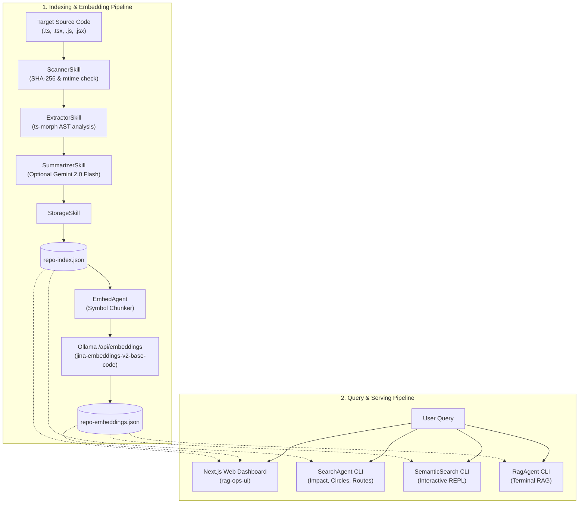

# Local AI Search Engine (RepoMind)

An AI-powered code search, dependency intelligence, and retrieval-augmented generation (RAG) platform designed for TypeScript and JavaScript codebases. RepoMind indexes repositories using Abstract Syntax Tree (AST) parsing via `ts-morph`, extracts code symbols and dependency relationships, computes vector embeddings locally via Ollama (`unclemusclez/jina-embeddings-v2-base-code`), and provides both an extensible command-line toolkit and an interactive Next.js web application (`rag-ops-ui`).

Developers can perform hybrid code search (combining vector similarity with Fuse.js fuzzy keyword matching), blast-radius impact analysis, circular dependency detection, and autonomous agentic workflows using local models (such as `qwen2.5:3b`) or larger GPU-hosted models (such as `Qwen 2.5 Coder 14B` running on Google Colab via a tunnel).

---

## Execution Modes, Privacy & Data Flow

Chat, RAG queries, and autonomous agent workflows are powered **exclusively by Ollama**. The application hardcodes all chat and embedding requests to `http://localhost:11434`. **Gemini is not a chat provider** in this platform; it is used solely by an optional offline file summarizer during codebase indexing (which is disabled by default in the code).

There are two ways to run Ollama for chat, plus an optional offline indexing tool:

| Mode / Feature | Scope | What Stays on Machine | What Is Sent Off Machine | Privacy Level | Notes |
| :--- | :--- | :--- | :--- | :--- | :--- |
| **Local Ollama (Chat & Embeddings)** | Chat & RAG | Entire source codebase, AST index (`repo-index.json`), vector database (`repo-embeddings.json`), embeddings computation, prompts, and completions | **Nothing** (0 bytes sent outside local machine) | **100% Private (Local-Only)** | All embeddings (`/api/embeddings`) and chat inferences (`/api/generate`, `/api/chat`) execute against `http://localhost:11434`. No external network requests are made. |
| **Colab-Hosted Ollama (via Tunnel & Port Forwarding)** | Chat & RAG | Source repository files, AST index, vector embeddings database | User prompt, retrieved code chunks (or full files read by agent tools), and model responses | **Shared with Cloud Host (Google Colab & Tunnel Provider)** | Inference runs on a remote Colab GPU instance. The tunnel must be forwarded back to local port 11434 so the application reaches it unchanged. Code chunks in the active context window travel across third-party infrastructure. |
| **Gemini API (Offline Indexing Only)** | Indexer Only *(Not Chat)* | Base AST index structure, vector embeddings | Source code file content sent for architectural summarization | **Cloud API (Google)** | **Not a chat mode.** Only used during `RepoIndexAgent` execution if `GEMINI_API_KEY` is provided and the summarizer is manually re-enabled (it is commented out by default in `RepoIndexAgent.ts` to conserve API quota). |

> [!IMPORTANT]
> - **Chat Supports Ollama Only**: Chat responses and agent reasoning cannot be routed to Gemini or other cloud providers. The codebase contains no provider abstraction for hosted chat APIs.
> - **Local Ollama** keeps all data on the machine: embedding generation and model inference remain strictly contained on `localhost`.
> - **Colab Mode** sends code context over the internet: retrieved code chunks, prompts, or source files are processed by the remote Colab runtime and tunnel provider. Do not use remote modes if working with proprietary code under strict air-gapped security policies.

---

## Target Codebase & Benchmark Evaluation

RepoMind is codebase-agnostic: configure `WORKSPACE_ROOT` to point to any local TypeScript or JavaScript repository (Next.js, React, Node.js) to scan, index, and analyze it.

During development and benchmark testing, the platform was evaluated on a large-scale enterprise TypeScript/Next.js production application comprising over 1,000 files across pages, components, and API routes.

**Core Guarantees**:
- **Local Artifact Storage**: All generated index files (`repo-index.json`) and vector databases (`repo-embeddings.json`) reside in the project root and are excluded by `.gitignore`.
- **Path-Traversal Guard**: The agent's file-reading tool validates that resolved file paths strictly reside inside the configured `WORKSPACE_ROOT`, preventing arbitrary filesystem access.

---

## Key Features

### 1. Codebase Scanning & AST Metadata Extraction
- **Recursive AST Scanning**: Traverses `.ts`, `.tsx`, `.js`, and `.jsx` files (ignoring `node_modules`, `.next`, `dist`, `build`, `coverage`, and `.git`).
- **Incremental Indexing**: Calculates SHA-256 content hashes and monitors filesystem modification timestamps (`mtime`) to re-index only new or modified files (`repo-indexer/ScannerSkill.ts`, `repo-indexer/RepoIndexAgent.ts`).
- **Deep Symbol Extraction**: Uses `ts-morph` with isolated dependency resolution to extract:
  - Components (PascalCase declarations)
  - React Hooks (`use*` naming convention)
  - Functions & Arrow Functions
  - Function call hierarchies (tracks child function invocations)
  - TypeScript types and interfaces
  - Imported and exported symbol tables
  - Lines of Code (LOC) and JSDoc documentation
- **Next.js App Router Awareness**: Identifies App Router pages, layouts, and API routes (`page.tsx`, `layout.tsx`, `route.ts`), parsing URL paths and route segments.
- **Optional Gemini Summarization**: Optional integration with `@google/genai` (`gemini-2.0-flash`) to generate concise architectural summaries when `GEMINI_API_KEY` is provided (`repo-indexer/SummarizerSkill.ts`).

### 2. Local Vector Embeddings & Storage
- **Granular Symbol Chunking**: Slices files into dedicated chunks per symbol (component, hook, function, route, type) enriched with imports and call references (`repo-indexer/EmbedAgent.ts`).
- **Local Ollama Embeddings**: Generates dense vector embeddings via a local Ollama instance (`http://localhost:11434/api/embeddings`) using `unclemusclez/jina-embeddings-v2-base-code`.
- **Deduplication & Incremental Saves**: Reuses existing vector embeddings for unchanged code chunks and periodically flushes progress to disk (`repo-embeddings.json`).

### 3. Graph Analysis & Codebase CLI Queries
The `SearchSkill` and `SearchAgent` CLI offer graph intelligence directly over `repo-index.json`:
- **Broad Symbol Search (`--find`)**: Searches across file paths, exports, components, hooks, functions, and types.
- **Reverse Dependency Lookup (`--who-uses`)**: Finds all files importing a specific symbol or path.
- **Next.js Route Inspection (`--route`)**: Matches URL endpoints to source route files.
- **Blast Radius & Impact Analysis (`--impact`)**: Traverses incoming dependency chains to generate a complete impact tree and flat list of affected files when modifying a symbol.
- **Circular Dependency Detection (`--find-circles`)**: Employs Depth-First Search (DFS) cycle traversal to detect circular import loops across the codebase.
- **Architecture Summarization (`--architecture`)**: Categorizes codebase files into Pages, Components, API Routes, Context & State, Utils & Hooks, and Other.
- **Top Dependencies (`--top-deps`)**: Ranks the most heavily imported files in the project.

### 4. Context Packaging & Terminal RAG
- **Token-Budgeted Context Builder**: Assembles structured context packages with strict token budgets (estimated at 4 characters per token). Performs Phase 1 (core semantic AST matches) followed by Phase 2 (1-hop dependency expansion) (`repo-indexer/ContextBuilderSkill.ts`).
- **Interactive Semantic REPL**: Terminal-based interactive search interface with cosine similarity calculations (`repo-indexer/SemanticSearch.ts`).
- **Terminal RAG Agent**: Command-line RAG pipeline that feeds assembled context packages and strict system prompts into local Ollama models (`qwen2.5:3b` by default) with real-time response streaming (`repo-indexer/RagAgent.ts`).
- **Telemetry Analyzer**: Parses JSONL conversation transcripts to output model reasoning steps, token usage estimates, and tool invocation counts (`repo-indexer/MetricsAnalyzer.ts`).

### 5. Autonomous Agent & Interactive Web Dashboard (`rag-ops-ui`)
Built with Next.js 16, React 19, and Tailwind CSS v4:
- **Real-Time Diagnostics**: Live status polling against Ollama (`/api/status`), displaying active server status and dynamically populating model selection menus.
- **Dual Chat Modes**:
  - **Standard RAG Mode**: Hybrid search query -> context retrieval -> streaming LLM response (includes a **Context Only** toggle to inspect raw retrieved code without invoking an LLM).
  - **Autonomous Agent Mode (`/api/agent`)**: An agentic loop executing multi-turn tool calling with built-in loop breakers and markdown JSON fallback parsing.
- **Agent Tools (`/api/agent`)**:
  - `search_codebase`: Runs hybrid search (vector cosine similarity + Fuse.js fuzzy keyword matching) against `repo-embeddings.json` and injects relevant code chunks. Includes a loop breaker that halts repetitive identical queries.
  - `read_entire_file`: Reads the complete raw file contents from the local disk when snippet chunks are insufficient, guarded against path traversal outside `WORKSPACE_ROOT`.
- **UI Reasoning Streaming**: Streams Server-Sent Events (SSE) emitting:
  - `status`: Real-time agent thought/action steps (e.g. `Running Hybrid Search for...`, `Reading entire file...`, `Formulating final answer...`), displayed as animated status updates in the chat window.
  - `context`: Dispatches retrieved file matches and estimated token metrics to the Context Inspector pane.
  - `token`: Streams the final text response.
  - `error`: Transmits execution errors.
- **Hybrid Search Scoring**: Blends 70% normalized vector cosine similarity with 30% Fuse.js fuzzy keyword matching (`/api/context`).
- **Context Inspector Pane**: Displays real-time matching code chunks, similarity scores, file paths, total character and token metrics, and provides a one-click clipboard copy of the raw context payload.
- **Markdown & Syntax Highlighting**: Renders responses using `react-markdown`, `remark-gfm`, and `react-syntax-highlighter` (`vscDarkPlus` theme).

---

## Tech Stack

### Web Application (`rag-ops-ui`)
| Category | Technology | Version |
| :--- | :--- | :--- |
| **Framework** | Next.js (App Router) | `16.2.10` |
| **UI Library** | React / React DOM | `19.2.4` |
| **Styling** | Tailwind CSS / PostCSS | `^4` / `@tailwindcss/postcss ^4` |
| **Typography** | `@tailwindcss/typography` | `^0.5.20` |
| **Icons** | Lucide React | `^1.24.0` |
| **Fuzzy Search** | Fuse.js | `^7.5.0` |
| **Markdown Rendering** | ReactMarkdown / remark-gfm | `^10.1.0` / `^4.0.1` |
| **Code Highlighting** | react-syntax-highlighter | `^16.1.1` |
| **TypeScript** | TypeScript | `^5` |

### Indexer & CLI Core (`repo-indexer`)
| Category | Technology | Version |
| :--- | :--- | :--- |
| **Runtime / Execution** | Node.js / `tsx` | Node 20+ / `^4.22.4` |
| **AST Analysis** | `ts-morph` | `^28.0.0` |
| **Cloud AI (Optional)** | `@google/genai` | `^2.9.0` |
| **Config Loader** | `dotenv` | `^17.4.2` |
| **TypeScript** | TypeScript | `^6.0.3` |

### Supported AI Models & Providers
- **Inference Engine**: [Ollama](https://ollama.com/) (hardcoded to `http://localhost:11434`)
- **Default Embedding Model**: `unclemusclez/jina-embeddings-v2-base-code` (512-dim code embeddings, computed locally via Ollama; also supports `nomic-embed-text`)
- **Default Local LLM**: `qwen2.5:3b` (lightweight, runs efficiently on consumer CPUs/laptops)
- **Remote GPU LLM (Colab / Cloud)**: `Qwen 2.5 Coder 14B` (`qwen2.5-coder:14b`), recommended for high-accuracy coding tasks when hosted on a GPU
- **Optional Indexer Summarizer**: `gemini-2.0-flash` (via Google GenAI SDK for offline indexing summaries only; disabled by default)

---

## Architecture Overview

```text
Local-AI-Search-Engine/
├── .gitignore                    # Excludes node_modules, build artifacts, db files, env
├── .env.example                  # Template for environment configuration
├── repo-index.json               # (Generated) AST metadata index (~13 MB)
├── repo-embeddings.json          # (Generated) Serialized vector database (~95 MB)
│
├── repo-indexer/                 # CLI Tools, AST Indexer & Agents
│   ├── ScannerSkill.ts           # Recursive file scanner with SHA-256 hash detection
│   ├── ExtractorSkill.ts         # ts-morph AST parser for symbols, calls, & imports
│   ├── SummarizerSkill.ts        # Optional Gemini API integration for file summaries
│   ├── StorageSkill.ts           # JSON persistence layer for repo-index.json
│   ├── RepoIndexAgent.ts         # Orchestrator for scanning and index generation
│   ├── EmbedAgent.ts             # Generates symbol embeddings via Ollama
│   ├── SearchSkill.ts            # Graph query engine (impact, circles, architecture)
│   ├── SearchAgent.ts            # CLI command wrapper for SearchSkill queries
│   ├── SemanticSearch.ts         # Interactive CLI REPL for semantic vector search
│   ├── ContextBuilderSkill.ts    # 2-phase token-budgeted context assembler
│   ├── ContextBuilderAgent.ts    # CLI runner for ContextBuilderSkill
│   ├── PromptBuilder.ts          # Formats strict RAG prompts
│   ├── RagAgent.ts               # Terminal-based streaming RAG execution via Ollama
│   ├── MetricsAnalyzer.ts        # Parses transcript logs for token and tool metrics
│   ├── package.json              # Dependencies for indexer tools
│   └── package-lock.json
│
└── rag-ops-ui/                   # Web Dashboard & API Server
    ├── public/                   # Static icons and assets
    ├── src/
    │   ├── middleware.ts         # Next.js request middleware
    │   └── app/
    │       ├── layout.tsx        # Root HTML layout with Geist font & metadata ("RepoMind")
    │       ├── page.tsx          # Dual-pane UI (Chat & Context Inspector)
    │       ├── globals.css       # Global styles and Tailwind directives
    │       └── api/
    │           ├── status/route.ts   # Checks Ollama health & available models (/api/tags)
    │           ├── context/route.ts  # Hybrid search (Ollama vector + Fuse.js) & metrics
    │           ├── generate/route.ts # Direct streaming LLM generation via Ollama
    │           └── agent/route.ts    # Autonomous Agent loop with tool-calling & SSE
    ├── next.config.ts
    ├── postcss.config.mjs
    ├── tsconfig.json
    ├── package.json
    └── package-lock.json
```

### Component Flow



---

## Setup & Configuration

### Prerequisites
1. **Node.js**: v20.x or newer (npm included).
2. **Ollama**: Installed and running (either locally or on a remote machine).

---

### Setup 1: Local Ollama Execution

1. **Install and Start Ollama**:
   Download and install from [ollama.com](https://ollama.com/).
   ```bash
   ollama serve
   ```

2. **Pull Required Local Models**:
   ```bash
   # Embedding model (512-dim code embeddings)
   ollama pull unclemusclez/jina-embeddings-v2-base-code

   # Lightweight local chat LLM
   ollama pull qwen2.5:3b

   # Optional: alternative embedding model for SemanticSearch REPL
   ollama pull nomic-embed-text
   ```

---

### Setup 2: Remote GPU Execution (Google Colab with Tunnel & Port Forwarding)

Running larger code models (like `Qwen 2.5 Coder 14B`) requires dedicated GPU memory (12 GB+ VRAM). You can host Ollama on a Google Colab GPU runtime and forward it back to `http://localhost:11434` on your local machine.

> [!NOTE]
> This is a **manual external networking setup**, not an in-app switch or configuration setting. The application code hardcodes `http://localhost:11434`, so the remote tunnel must be forwarded back to local port 11434 for the application to reach it without code changes.

<!-- TODO: Add a ready-to-run Colab setup notebook (e.g. colab_ollama_qwen14b.ipynb) to the repository to automate Colab deployment. -->

1. **Colab Notebook Setup**:
   Open a new notebook in [Google Colab](https://colab.research.google.com/) and set the runtime to **T4 GPU** or **A100 GPU** (`Runtime > Change runtime type > T4 GPU`).

2. **Install Ollama & Pull the 14B Model in Colab**:
   ```python
   # Cell 1: Install Ollama
   !curl -fsSL https://ollama.com/install.sh | sh

   # Cell 2: Start Ollama in the background
   import subprocess
   subprocess.Popen(["ollama", "serve"])

   # Cell 3: Pull Qwen 2.5 Coder 14B and the embedding model
   !ollama pull qwen2.5-coder:14b
   !ollama pull unclemusclez/jina-embeddings-v2-base-code
   ```

3. **Expose Port 11434 via Tunnel (e.g., ngrok or Cloudflared)**:
   ```python
   # Cell 4: Install pyngrok and open tunnel
   !pip install pyngrok
   from pyngrok import ngrok
   # Set your auth token if required: ngrok.set_auth_token("YOUR_TOKEN")
   tunnel = ngrok.connect(11434, "http")
   print("Tunnel Public URL:", tunnel.public_url)
   ```

4. **Forward the Remote Tunnel to `http://localhost:11434` Locally**:
   - Forward the public tunnel URL back to `localhost:11434` on your local machine (for example, using a local reverse proxy or SSH/TCP port forwarding), so that requests to `http://localhost:11434` are routed through the tunnel to the Colab GPU.
   - When `rag-ops-ui` runs, it will connect to `http://localhost:11434` unchanged and display `qwen2.5-coder:14b` in the model dropdown.

---

### Setup 3: Optional Offline Indexing Tool (Gemini API Summarizer)

> [!NOTE]
> Gemini is **not a chat or RAG model** in this platform. It exists solely as an optional file summarization helper in `repo-indexer/SummarizerSkill.ts` during codebase indexing, and is currently commented out by default in `RepoIndexAgent.ts` (lines 56–63) to conserve API quota.

1. Obtain an API key from [Google AI Studio](https://aistudio.google.com/).
2. Add `GEMINI_API_KEY` to your `.env.local` file.
3. If uncommented in `RepoIndexAgent.ts`, `SummarizerSkill.ts` will call `@google/genai` (`gemini-2.0-flash`) to generate architectural file summaries. If the key is omitted or the code remains commented out, summaries default to `"Summary Generation Disabled."` with zero network requests.

---

### Installation & Environment

1. Clone or open the repository:
   ```bash
   cd Local-AI-Search-Engine
   ```

2. Install dependencies:
   ```bash
   # Indexer CLI tools
   cd repo-indexer && npm install && cd ..

   # Web application
   cd rag-ops-ui && npm install && cd ..
   ```

3. Configure environment variables:
   ```bash
   cp .env.example .env.local
   ```

#### Environment Variables Reference

| Variable | Scope | Description | Default / Requirement |
| :--- | :--- | :--- | :--- |
| `WORKSPACE_ROOT` | Global | Path to the target repository to scan, index, and read. Used by `rag-ops-ui` (`/api/agent`) for `read_entire_file` (with path-traversal guards) and by `repo-indexer` CLI agents. | Optional. Defaults to `process.cwd()`. |
| `GEMINI_API_KEY` | Indexer | *(Optional)* Google Gemini API key required strictly for architectural summaries in `repo-indexer/SummarizerSkill.ts`. Not used for chat. | Optional. If missing, summaries use placeholder text. |

---

## Running the Platform

### Step 1: Index the Target Codebase
Generate the AST metadata index `repo-index.json` (indexes project root, or path specified by `WORKSPACE_ROOT`):
```bash
cd repo-indexer
npx tsx RepoIndexAgent.ts
```
*(Add `--force` to re-extract all files regardless of timestamps or hashes)*.

### Step 2: Generate Vector Embeddings
Generate `repo-embeddings.json` via local Ollama embeddings:
```bash
cd repo-indexer
npx tsx EmbedAgent.ts
```

### Step 3: Run Codebase CLI Tools
Run queries against the generated AST and vector databases:
```bash
cd repo-indexer

# Find symbols, components, or files
npx tsx SearchAgent.ts --find "Button"

# Reverse dependency lookup: find all files importing a symbol
npx tsx SearchAgent.ts --who-uses "useAuthentication"

# Match Next.js URL routes to source files
npx tsx SearchAgent.ts --route "/api/users"

# Calculate blast radius impact graph
npx tsx SearchAgent.ts --impact "UserProfileCard"

# Detect circular dependency import loops
npx tsx SearchAgent.ts --find-circles

# Print architectural domain breakdown
npx tsx SearchAgent.ts --architecture

# List top most-imported dependencies
npx tsx SearchAgent.ts --top-deps

# Launch interactive terminal semantic search REPL
npx tsx SemanticSearch.ts

# Run terminal-based RAG query
npx tsx RagAgent.ts "How does user authentication work in this repo?" --model qwen2.5:3b
```

### Step 4: Run the Web Dashboard (`rag-ops-ui`)
Start the Next.js development server:
```bash
cd rag-ops-ui
npm run dev
```
Open [http://localhost:3000](http://localhost:3000) in your browser.

---

## API Endpoints (`rag-ops-ui`)

| Endpoint | Method | Description | Request Body | Response |
| :--- | :--- | :--- | :--- | :--- |
| `/api/status` | `GET` | Health check against Ollama (`/api/tags`). | None | `{ status: "online" \| "offline", models: Array<{ name: string }> }` |
| `/api/context` | `POST` | Hybrid vector + Fuse.js search over `repo-embeddings.json`. | `{ query: string, topN?: number, embeddingModel?: string }` | `{ matches: Match[], rawContext: string, metrics: { charCount: number, estimatedTokens: number } }` |
| `/api/generate` | `POST` | Streams response from Ollama `/api/generate` using supplied context package. | `{ query: string, rawContext: string, llmModel?: string }` | Server-Sent Event (SSE) text stream from Ollama. |
| `/api/agent` | `POST` | Autonomous agent loop (max 8 iterations) with tool-calling capabilities. | `{ query: string, history?: Message[], llmModel?: string, embeddingModel?: string, topN?: number }` | Server-Sent Event (SSE) stream with event types: `status`, `context`, `token`, `error`. |

---

## Known Limitations & Architectural Trade-offs

1. **No Provider Abstraction Layer**:
   - There is no unified provider interface or abstraction layer in the codebase. The application directly calls Ollama REST endpoints (`/api/chat`, `/api/generate`, `/api/embeddings`, `/api/tags`).
   - Using hosted APIs (such as OpenAI, Anthropic, Gemini, or Groq) for chat or agent workflows cannot be done through configuration and would require manual code modifications in `generate/route.ts`, `agent/route.ts`, `status/route.ts`, and the model dropdown in `page.tsx`.
2. **Hardcoded Ollama Base URL**:
   - The Ollama endpoint is hardcoded to `http://localhost:11434` across all API routes (`generate/route.ts`, `agent/route.ts`, `context/route.ts`, `status/route.ts`) and indexer CLI scripts (`EmbedAgent.ts`, `SemanticSearch.ts`, `ContextBuilderSkill.ts`, `RagAgent.ts`).
   - The backend cannot be pointed to a remote host or tunnel URL via configuration; connecting to a remote Colab instance requires forwarding the tunnel back to `localhost:11434` locally.
3. **AST Indexing Limited to TypeScript and JavaScript**:
   - AST extraction via `ts-morph` is limited strictly to `.ts`, `.tsx`, `.js`, and `.jsx` files. Other languages in polyglot codebases (e.g., Python, Go, Rust, Java, CSS, HTML) are skipped by the AST symbol extractor.
4. **Google Colab Session Timeouts & Tunnel Volatility**:
   - Free Google Colab GPU sessions automatically disconnect after periods of inactivity (typically 30–90 minutes) or reach a hard session cutoff (12 hours).
   - Tunnel endpoints (e.g., ngrok or cloudflared) regenerate new public URLs each time the Colab notebook restarts, requiring manual reconfiguration of local port forwarding.
5. **Privacy Trade-offs in Remote Modes**:
   - Running inference via Google Colab or summarization via the Gemini API transmits code context (user prompts, retrieved snippets, or file source code) over the public internet to third-party infrastructure. Only Local Ollama mode guarantees local-only privacy.
6. **Hardware Requirements for 14B Models**:
   - Larger coding models such as `Qwen 2.5 Coder 14B` require a dedicated GPU with at least 12–16 GB of VRAM. Attempting to run 14B models locally on consumer CPU hardware results in severe inference latency.
7. **Monolithic JSON Vector Database**:
   - Both `repo-index.json` (~13 MB) and `repo-embeddings.json` (~95 MB) are flat JSON files loaded entirely into Node.js memory. While acceptable for mid-size repositories (~1,000 files), massive enterprise codebases with tens of thousands of files would require an embedded vector database (e.g., SQLite with sqlite-vss, DuckDB, LanceDB, or Chroma).
8. **Disabled Summarization in Indexer Loop**:
   - In `repo-indexer/RepoIndexAgent.ts` (lines 56–63), AI summarization via `SummarizerSkill` is commented out by default (`// Summarizer temporarily disabled to save API quota`) and defaults to `"Summary Generation Disabled."`.
9. **Heuristic Token Counting**:
   - Token metrics in the Context Inspector use a character-length estimation (`charCount / 4`) rather than exact BPE tokenization.

---

## Screenshots / UI Layout

```text
+----------------------------------------------------------------------------------------------------+
|  [Bot] RepoMind               LLM: [qwen2.5:3b v]  [x] Agent Mode   [ ] Context Only               |
+-----------------------------------------------------------------+----------------------------------+
| LEFT PANE: Chat Window                                          | RIGHT PANE: Diagnostics          |
|                                                                 |                                  |
| > User: "How does the authentication flow work?"                | [Server] Ollama Online           |
|                                                                 | Embedding Engine: jina-base-code |
| > Assistant:                                                    | Top N Chunks: [=====o-----] 5    |
|   🔄 *Running Hybrid Search for: "authentication flow"...*      |                                  |
|   🔄 *Found 3 matching files. Reading the code...*             | Payload Metrics:                 |
|   🔄 *Formulating final answer...*                              | - Total Characters: 14,230       |
|                                                                 | - Estimated Tokens: ~3,558       |
|   The authentication flow is initiated in `useAuthentication`   | [Copy Raw Context Button]        |
|   which calls the `/api/login` endpoint...                      |                                  |
|                                                                 | Semantic Matches:                |
|   ```tsx                                                        | - useAuthentication (hook) 0.88  |
|   export const useAuthentication = () => { ... }                | - AuthProvider (comp)      0.82  |
|   ```                                                           | - api/login/route.ts (api) 0.79  |
+-----------------------------------------------------------------+----------------------------------+
| [ Input: "Type a natural language query..."                   ] [ Run > ]                          |
+----------------------------------------------------------------------------------------------------+
```

---

## Future Work

- [ ] **Provider Abstraction Layer**: Introduce a unified provider interface so users can route chat and agent queries to hosted APIs (OpenAI, Anthropic, Gemini, Groq) via configuration without code edits.
- [ ] **Configurable Ollama URL**: Refactor all indexer scripts and Next.js API routes to read a configurable base URL environment variable rather than hardcoding `http://localhost:11434`.
- [ ] **Colab Automation Notebook**: Add a ready-to-run `.ipynb` notebook to the repository automating Ollama installation, model pulling, and tunnel creation on Google Colab.
- [ ] **Embedded Vector Database**: Migrate flat `repo-embeddings.json` storage to LanceDB or SQLite-VSS for on-disk indexed vector queries and reduced memory consumption.
- [ ] **Tokenizer Integration**: Integrate an exact BPE tokenizer (e.g. `tiktoken` or `@dqbd/tiktoken`) to replace heuristic `charCount / 4` estimation.
- [ ] **Multi-Language AST Support**: Extend AST extraction beyond TypeScript/JavaScript using tree-sitter bindings for Python, Go, and Rust.
